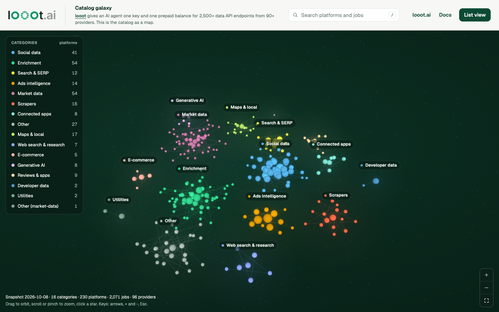
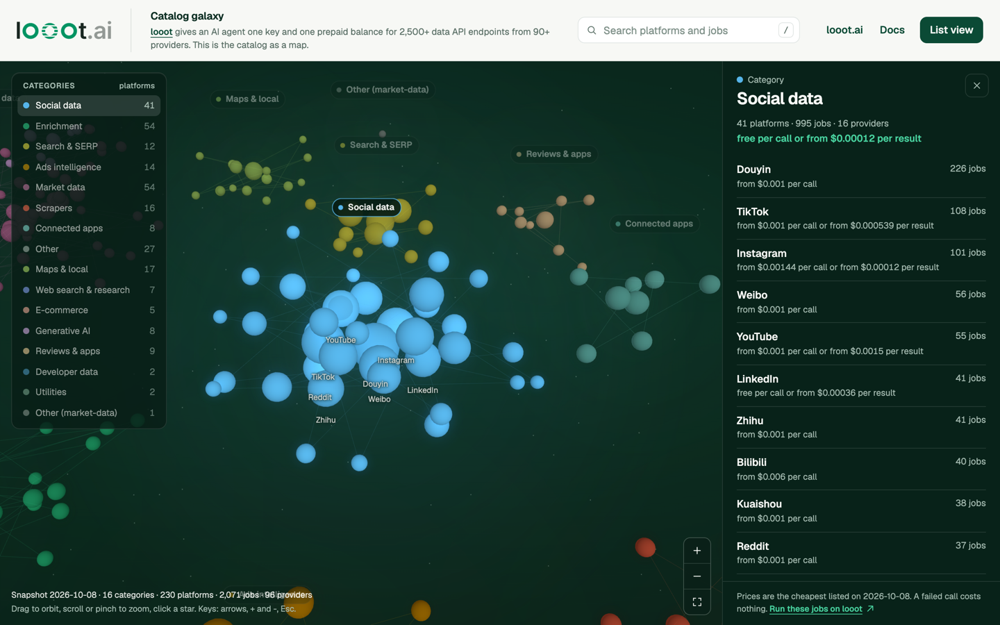
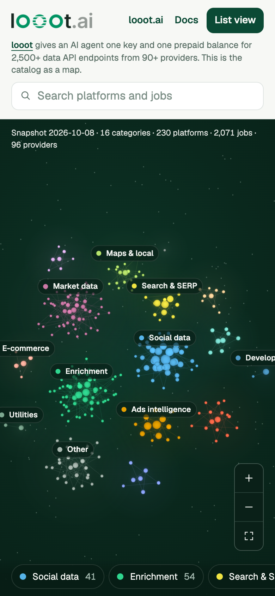

# Catalog galaxy

A 3D map of the [looot](https://looot.ai) data API catalog. Open it: **https://loootai.github.io/catalog-galaxy/**

[](https://loootai.github.io/catalog-galaxy/)

[looot](https://looot.ai) gives an AI agent one key and one prepaid balance for 2,500+ data API endpoints from 90+ providers: work emails, company and people search, Google results, web pages, social profiles, local businesses. The agent searches the catalog, sees the price before it runs, and pays per call. A failed call costs nothing. Docs: [docs.looot.ai](https://docs.looot.ai).

This site shows that catalog as a map you can fly around.

- Each cluster is one of the 16 categories. Each star is a platform, sized by how many jobs it has.
- Hover a star for its job count and cheapest listed price. Click it to read every job with its `job:<id>` and price.
- Search covers platform names and all 2,071 job titles and ids, and moves the camera to the match.
- The list view holds the same content as plain sections. It is the default when your system asks for reduced motion or the browser has no WebGL.

| Category view | Phone |
| --- | --- |
|  |  |

## Controls

| Input | Action |
| --- | --- |
| Drag, or one finger | Orbit |
| Scroll, or pinch | Zoom |
| Shift + drag, or right drag | Pan |
| Click or tap a star | Open the platform |
| Arrow keys | Orbit |
| `+` and `-` | Zoom |
| `Tab`, then `Enter` | Walk the category list and open one |
| `/` | Focus the search box |
| `Esc` | Step back: platform, category, whole map |
| `0` | Show the whole map |

A link such as `https://loootai.github.io/catalog-galaxy/#/enrichment/people` opens straight on a platform.

## Where the data comes from

`npm run snapshot` reads the free, public endpoint `GET https://api.looot.ai/v1/catalog/overview?depth=jobs` (no token) and rewrites two things:

- `src/data/catalog.json`: the snapshot date, the catalog revision, totals, categories and platforms. It is bundled with the page.
- `public/data/jobs/<category>.json`: the jobs of each category. The page fetches a file the first time you open a platform in it, or when you focus the search box.

The committed snapshot is from 2026-10-08: 16 categories, 230 platforms, 2,071 jobs, 96 providers. A platform listed under two categories is one platform in that total and one star in each category, so the map draws 277 stars.

Prices are the cheapest listed across a job's providers on the snapshot date. Some providers bill per call and some per result, so a job can show both. "free" is printed only when the listed value is exactly 0, and "n/a" when no price is listed. For live prices use the [looot catalog](https://looot.ai) or the API.

## Run it locally

Needs Node 22.18 or newer.

```bash
git clone https://github.com/loootai/catalog-galaxy && cd catalog-galaxy
npm ci --ignore-scripts
npm run dev        # http://localhost:5173/catalog-galaxy/
npm run snapshot   # refresh the data, then commit the changed JSON
npm test
npm run typecheck
npm run build      # static site in dist/
```

Pushing to `main` runs `.github/workflows/pages.yml`, which tests, builds and deploys `dist/` to GitHub Pages.

## How it is built

- [Three.js](https://threejs.org) 0.186.1, [Vite](https://vite.dev) 8.3.1, TypeScript. No framework. Every dependency is pinned to an exact version.
- All stars are one `InstancedMesh` and one draw call. Halos are one `Points` object. The page draws a frame only when the camera or the selection changes, so an idle tab uses no GPU time. Device pixel ratio is capped at 2.
- The layout is a seeded function (`src/lib/layout.ts`), so the map is the same on every visit. Larger categories sit nearer the middle.
- Three.js loads only when the 3D view starts. The list view never downloads it.
- Category colours start from the Okabe-Ito palette and every cluster, row and tooltip also carries its name, so colour is never the only cue.

## License

MIT. See [LICENSE](LICENSE). The looot name and logo belong to looot.
